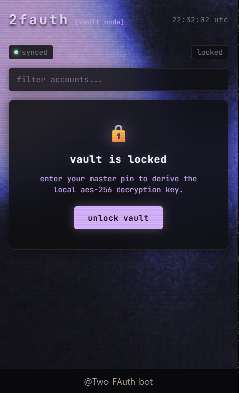

# 2FAuth

2FAuth is a zero-knowledge, open-source 2FA authenticator built from scratch on Cloudflare Workers (V8 Isolates) and Cloudflare D1 (SQLite at the edge). It combines a Telegram bot with an interactive glassmorphic Mini App featuring real-time circular countdown timers and client-side Web Crypto decryption.



---

## How It Works

Traditional authenticator apps either lock your 2FA seeds inside a proprietary local sandbox (lost forever if your phone breaks) or sync them to proprietary clouds with closed-source encryption.

2FAuth solves this by moving storage to global SQLite edge nodes (Cloudflare D1) while enforcing a strict **zero-knowledge cryptographic boundary**: the edge database only ever sees AES-256-GCM ciphertexts. The server never learns your master PIN, never stores your plaintext encryption key, and cannot read your 2FA seeds.

### 1. Zero-Knowledge Cryptographic Vault
- **PBKDF2 Key Stretching:** When you configure your 4 to 8 digit Master PIN, the engine generates a cryptographically random 16-byte salt (`crypto.getRandomValues`) and stretches it through **100,000 rounds of PBKDF2-HMAC-SHA-256** to derive an AES-256 encryption key.
- **Verification Without Knowledge:** To verify your PIN without storing it, the system computes a SHA-256 digest of your PIN combined with the unique salt. Cloudflare D1 only stores this verifier hash.
- **AES-256-GCM Authenticated Encryption:** Every 2FA seed is encrypted with a unique 12-byte initialization vector (`iv`). AES-GCM guarantees both confidentiality and cryptographic integrity against ciphertext tampering.
- **Emergency Recovery Key:** On initial setup, the vault generates an offline 20-byte base-32 recovery key (`XXXX-XXXX-XXXX-XXXX-XXXX`) derived via its own independent salt and verifier. If you lose your PIN, the recovery key restores access and re-encrypts your vault.

### 2. Pure Web Crypto RFC 6238 TOTP Engine
The TOTP math engine runs natively on Web Crypto with zero external crypto dependencies:
- **Base32 Decoder:** Normalizes RFC 4648 Base32 alphabet keys, removes padding, and unpacks bitstreams into raw byte buffers.
- **Epoch Counter:** Computes integer intervals `T = floor((epochSeconds - T0) / X)` using a 30-second time step `X`. The counter is encoded as an 8-byte big-endian binary buffer.
- **HMAC-SHA1 & Dynamic Truncation:** Signs the 8-byte counter buffer using native HMAC-SHA1. The last 4 bits of the 20-byte hash determine the dynamic offset (`offset = hash[19] & 0x0f`). A 31-bit integer is extracted from `hash[offset ... offset+3]` and modulo-reduced (`binary % 10^6`) to yield the rolling 6-digit code.

### 3. Native Bitstream QR Code Decoding
When you upload a 2FA QR code screenshot to the Telegram chat:
- Inspects byte magic numbers to distinguish **PNG** (`0x89 0x50 0x4E 0x47`) from **JPEG** (`0xFF 0xD8`).
- Pure JavaScript bitstream pixel decoders (`pngjs` and `jpeg-js`) unpack raw RGBA pixel arrays directly in Cloudflare V8 memory without Node canvas or C++ binaries.
- Scans QR matrix markers with `jsqr`, extracts `otpauth://totp/` parameters (issuer, account label, algorithm, digits), encrypts the secret immediately, and purges the raw image.

### 4. Mini App
- **Dual Interface:** Use standard Telegram chat commands (`/list`, `/add`, `/unlock`) or tap the persistent **2FAuth** button to open the web app.
- **Zero-Disk In-Memory Execution:** The master key is derived inside your browser's Web Crypto memory and never written to disk or storage. Closing the sheet wipes the memory immediately.
- **Live SVG Circular Timers:** Real-time 60fps countdown rings shrink smoothly from 30s down to 0s, shifting dynamically from mint green (`#a7f3d0`) to coral red (`#fca5a5`) in the final 5 seconds.
- **1-Tap Clipboard Engine:** Dual-mode clipboard handler (modern `navigator.clipboard` with an automatic legacy `execCommand` fallback) guarantees one-tap copying across all iOS, Android, and desktop Telegram WebViews.

---
## Requirements

- Node.js 22+
- Cloudflare Account & [Wrangler CLI](https://developers.cloudflare.com/workers/wrangler/)
- A Telegram Bot Token from [@BotFather](https://t.me/BotFather)

---

## Setup & Deployment

### 1. Clone & Install

```bash
git clone https://github.com/Yonathan-T/2FAuth.git
cd 2FAuth
npm install
```

### 2. Configure Cloudflare D1 Database

Create a remote D1 database on your Cloudflare account:

```bash
npx wrangler d1 create 2fauth_db
```

Copy the generated `database_id` into your [`wrangler.toml`](./wrangler.toml):

```toml
[[d1_databases]]
binding = "DB"
database_name = "2fauth_db"
database_id = "your-database-id-here"
migrations_dir = "migrations"
```

Apply database migrations to your remote D1 database:

```bash
npx wrangler d1 migrations apply DB --remote
```

### 3. Set Bot Secret

Upload your Telegram Bot Token to Cloudflare Workers secret storage:

```bash
npx wrangler secret put BOT_TOKEN
```
*(Paste your token from BotFather when prompted).*

### 4. Deploy to Cloudflare

Deploy the worker to Cloudflare's global edge:

```bash
npx wrangler deploy
```

### 5. Register Telegram Webhook

Link Telegram's webhook to your deployed Cloudflare Worker:

```bash
curl -X POST "https://api.telegram.org/bot<YOUR_BOT_TOKEN>/setWebhook?url=https://<YOUR_WORKER_URL>/webhook"
```

---

## Usage

### 1. Initializing Your Vault
1. Open your bot in Telegram and send `/start`.
2. Configure your master PIN:
   ```text
   /setpin 1234
   ```
   *(Choose 4 to 8 digits. The bot deletes your message immediately for privacy).*
3. Save your **Emergency Recovery Key** in a secure offline location.

### 2. Adding Accounts
You can add 2FA accounts three ways:
- **QR Code Screenshot:** Send any 2FA QR code photo or screenshot directly to the bot.
- **URI String:** Send any `otpauth://totp/...` link into chat or paste it into the Mini App.
- **Manual Command:**
  ```text
  /add GitHub JBSWY3DPEHPK3PXP
  ```

### 3. Generating TOTP Codes
- **In Chat:** Send `/list`. Tap any account button to display its rolling 6-digit code, text countdown, and 1-tap copy format.
- **In Mini App:** Tap the **2FAuth** menu button. Enter your PIN to view all accounts simultaneously with real-time circular countdown timers and instant search filtering.

### 4. Auto-Lock & Session Security
- Send `/lock` to wipe your active session key immediately.
- Customize your auto-lock timeout duration:
  ```text
  /timeout 15
  ```
- If you lose your PIN, recover your vault using your recovery key:
  ```text
  /recover <RECOVERY_KEY> <NEW_PIN>
  ```

---

## Tests & Verification

The repository contains 29 unit tests with zero mocking frameworks, testing against official RFC 6238 IETF test vectors, PBKDF2/AES round-trip encryption, and SQL schema constraints:

```bash
npm test
```

Test coverage includes:
- **RFC 6238 Test Vectors:** Asserts exact 6-digit, 8-digit, and leading-zero code parity across standard Unix timestamps (59s, 1111111109s, 1234567890s, 2000000000s).
- **Zero-Knowledge Round Trip:** Asserts PBKDF2-derived AES-GCM ciphertexts decrypt cleanly with matching PINs and fail authentication checks with incorrect PINs.
- **Bitstream QR Decoding:** Verifies corrupt byte rejection and valid OTPAuth URI extraction from raw image buffers.
- **Session Lifecycle:** Validates timeout expiration and cascade deletion on D1 SQLite tables.

---

## Security Model

| Component | Implementation | Threat Mitigation |
| :--- | :--- | :--- |
| **PIN Storage** | Never stored in plain text or reversible form | Immune to database leak attacks |
| **Seed Encryption** | AES-256-GCM with unique 12-byte IV per record | Cryptographically authenticated ciphertext |
| **Key Derivation** | PBKDF2-HMAC-SHA-256 (100,000 iterations) | Protects against offline GPU brute-force |
| **Telegram Privacy** | Auto-deletes all `/setpin`, `/unlock`, and `/recover` messages | Prevents shoulder surfing and chat screen leaks |
| **Mini App Memory** | Plaintext keys exist only in volatile browser RAM | Zero persistence to disk or browser storage |

---

## Contributing & Support

Contributions, feature requests, and bug reports are welcome. If you find 2FAuth useful, consider leaving a ⭐ on GitHub!

---

## License

MIT © [Yonathan-T](https://github.com/Yonathan-T)
